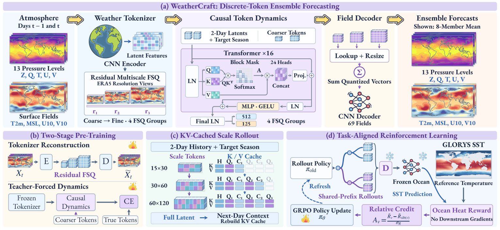
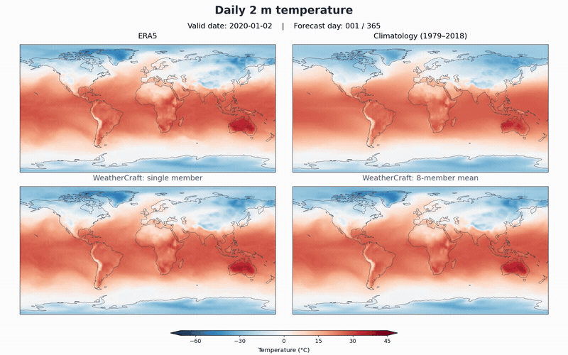

# WeatherCraft

Discrete weather tokens for autoregressive ensemble forecasting and post-training.

This repository contains the multiscale tokenizer, weather dynamics model,
daily-data baseline adaptations, two-stage fair-CRPS training, and land/ocean
Vanilla and Tree GRPO. Datasets, checkpoints, and experimental outputs
are not included.

## Model overview



*Figure 2 from the paper: multiscale tokenization, causal weather dynamics,
latent rollout, and task-aligned post-training.*

## One-year rollout

[](docs/assets/annual_rollout.mp4)

*Daily 2 m temperature over a 365-day rollout: ERA5, climatology (1979–2018),
WeatherCraft single member, and eight-member mean. The GIF shows all 59 consecutive daily frames from January 2 to February 29, 2020; the
[MP4 video](docs/assets/annual_rollout.mp4) contains all 365 daily frames.*

## Setup

Use Python 3.10 or 3.11 and a CUDA-enabled PyTorch 2.6 environment.

```bash
pip install -r requirements.txt
pip install -e . --no-deps
export ERA5_ROOT=/path/to/era5
```

Prepare the daily ERA5 arrays described in [Data](docs/data.md), then set the
paths in `configs/data.yaml`. Training uses 1979–2018, validation uses 2019,
and the forecast test set uses 2020–2022.

## Train and forecast

Run commands from the repository root. The supplied training configurations use
eight GPUs.

```bash
torchrun --standalone --nproc_per_node=8 -m weathercraft.train.tokenizer
# Set tokenizer_checkpoint in configs/dynamics.yaml to the selected tokenizer.
torchrun --standalone --nproc_per_node=8 -m weathercraft.data.cache
torchrun --standalone --nproc_per_node=8 -m weathercraft.train.dynamics
torchrun --standalone --nproc_per_node=8 -m weathercraft.evaluation.forecast \
  --config configs/dynamics.yaml --checkpoint /path/to/dynamics.pt \
  --output runs/evaluation/base
```

For pretrained checkpoints, start with the final command after configuring the
tokenizer path. Forecast metrics use cosine-latitude weighting; nRMSE averages
squared errors before the square root. Requested leads are scored separately.

## Post-training and baselines

- [Post-training](docs/posttraining.md): one-day → two-day fair-CRPS; land/ocean GRPO.
- [Baselines](docs/baselines.md): model configurations, dependencies, and commands.

```text
weathercraft/   tokenizer, dynamics, data, inference, evaluation, post-training
baseline/       deterministic models, GenCast, Tyche
configs/        model and training configurations
docs/           data and usage notes
```

Third-party notices are retained beside the corresponding source; see
[Sources](SOURCES.md).
